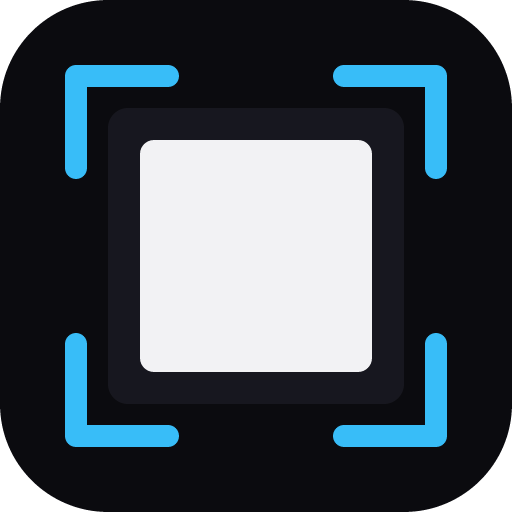

<div align="center">
  <br>
  
  <h1>✂️ EdgeCut</h1>
  <p><b>画像の背景余白を自動検出・トリミングするデスクトップ GUI ツール</b></p>
  <p>
    <sub>Rust 製 &nbsp;·&nbsp; egui によるリアルタイムプレビュー &nbsp;·&nbsp; Windows / Linux / macOS</sub>
  </p>
  <br>
  <a href="https://www.rust-lang.org/">
    
  </a>
  <a href="./LICENSE">
    
  </a>
  
  
  
  <a href="https://github.com/emilk/egui">
    
  </a>
  <br><br>
</div>

---

<br>

<table align="center">
  <tr>
    <td align="center" width="210">
      <h3>⚡</h3>
      <b>リアルタイムプレビュー</b><br><br>
      <sub>スライダー操作に即時追従。<br>元画像とトリミング後を<br>左右に並べて比較</sub>
    </td>
    <td align="center" width="210">
      <h3>🎨</h3>
      <b>柔軟な背景色指定</b><br><br>
      <sub>自動検出・カラーピッカー<br>スポイト・手動 RGBA 編集</sub>
    </td>
    <td align="center" width="210">
      <h3>📦</h3>
      <b>一括処理</b><br><br>
      <sub>複数ファイルをバックグラウンドで<br>並列トリミング。<br>UI をブロックしない</sub>
    </td>
    <td align="center" width="210">
      <h3>🌍</h3>
      <b>クロスプラットフォーム</b><br><br>
      <sub>Windows / Linux / macOS。<br>設定は次回起動時に<br>自動復元</sub>
    </td>
  </tr>
</table>

<br>

---

## 目次

- [概要](#概要)
- [動作の仕組み](#動作の仕組み)
- [機能](#機能)
- [クイックスタート](#クイックスタート)
- [使い方](#使い方)
- [対応フォーマット](#対応フォーマット)
- [読み込み上限](#読み込み上限)
- [要件](#要件)
- [ビルド](#ビルド)
- [開発](#開発)
- [ライセンス](#ライセンス)

---

## 概要

EdgeCut は、画像の四辺から背景色を推定し、余白を除去するデスクトップアプリケーションです。  
スクリーンショットの周囲余白、単色背景のイラスト、透過 PNG の外側などを、許容度と余白ピクセルを調整しながらプレビューできます。

---

## 動作の仕組み

<table>
  <tr>
    <td align="center" valign="top" width="100">
      <br>
      <kbd>&nbsp;Step 1&nbsp;</kbd>
      <br><br>
    </td>
    <td valign="top">
      <br>
      <b>背景色の検出</b><br>
      画像の上・下・左・右の全辺ピクセルを走査し、最頻出の RGBA 値を背景色とする。四隅のみを参照する方式より、角が丸い素材や隅に異なる色がある画像でも誤検出しにくい
      <br><br>
    </td>
  </tr>
  <tr>
    <td align="center" valign="top">
      <br>
      <kbd>&nbsp;Step 2&nbsp;</kbd>
      <br><br>
    </td>
    <td valign="top">
      <br>
      <b>余白の判定</b><br>
      各ピクセルが背景色と「許容度」内で一致するかを RGB の二乗距離で判定する。アルファ値が 16 未満のほぼ完全透明ピクセルも背景として扱う
      <br><br>
    </td>
  </tr>
  <tr>
    <td align="center" valign="top">
      <br>
      <kbd>&nbsp;Step 3&nbsp;</kbd>
      <br><br>
    </td>
    <td valign="top">
      <br>
      <b>トリミング</b><br>
      上下左右から背景と判定された領域を除去し、必要に応じて四辺へ指定ピクセル数の余白を追加する
      <br><br>
    </td>
  </tr>
</table>

> 💡 背景色は自動検出のほか、カラーピッカーでの手動指定や元画像のスポイトでも上書きできます。

---

## 機能

<details open>
<summary>✂️ &nbsp;<b>トリミング</b></summary>
<br>

| 機能 | 説明 |
| ---- | ---- |
| 自動余白除去 | 四辺の最頻色を背景として検出し、上下左右の余白を除去 |
| 許容度調整 | 0〜100 の範囲で背景色との類似度閾値を設定 |
| 余白追加 | トリミング後に 0〜100 px の余白を四辺に追加 |
| 背景色の指定 | 自動検出 / カラーピッカー / スポイト / 手動 RGBA 編集 |

</details>

<details open>
<summary>📂 &nbsp;<b>入出力</b></summary>
<br>

| 機能 | 説明 |
| ---- | ---- |
| ファイルを開く | ダイアログ選択、ドラッグ & ドロップ |
| クリップボード | 画像の貼り付け読み込み、トリミング結果のコピー |
| 保存 | ファイルダイアログから任意のパスへ出力 |
| 自動保存 | 画像を開いた直後に指定フォルダへ自動保存 |
| 一括トリミング | 複数ファイルをまとめて処理 (`{名前}_trimmed.{拡張子}`) |

</details>

<details open>
<summary>🖥️ &nbsp;<b>UI</b></summary>
<br>

| 機能 | 説明 |
| ---- | ---- |
| 並列プレビュー | 元画像とトリミング後を左右に並べて表示 |
| コンパクト UI | トリミング後の画像のみを表示する省スペースモード |
| ダーク / ライト | テーマをワンクリックで切り替え |
| 設定の永続化 | 許容度・余白・テーマ・自動保存先などを次回起動時に復元 |

</details>

---

## クイックスタート

リリースバイナリをお持ちでない場合は、Rust ツールチェーンをインストールしたうえで次を実行します。

```bash
cargo run --release
```

> Windows で MSI インストーラーを作成する場合は [ビルド](#ビルド) の Windows セクションを参照してください。

---

## 使い方

<details open>
<summary>📋 &nbsp;<b>基本的な流れ</b></summary>
<br>

| ステップ | 操作 | 説明 |
| :------: | ---- | ---- |
| **1** | **画像を開く** | 「📂 開く」でファイルを選択、ウィンドウへドラッグ & ドロップ、または「📋 貼り付け」でクリップボードから読み込み |
| **2** | **許容度を調整** | スライダーで背景色の許容範囲を設定 (0: 完全一致に近い、100: 広い範囲を余白とみなす) |
| **3** | **余白を調整** | トリミング後に追加したい余白ピクセル数を設定 (0〜100 px) |
| **4** | **結果を出力** | 「💾 保存」でファイルへ書き出す、または「📋 コピー」でクリップボードへコピー |

スライダーはドラッグ中もプレビューが更新されます。ホバー中に <kbd>←</kbd> <kbd>→</kbd> キーでも値を微調整できます。

</details>

<details open>
<summary>🎨 &nbsp;<b>背景色の調整</b></summary>
<br>

自動検出で意図とずれる場合は、ツールバー右側の背景色コントロールで上書きできます。

| 操作 | 説明 |
| ---- | ---- |
| **自動** | 四辺から背景色を再検出する (手動指定を解除) |
| **カラーピッカー** | RGBA を直接編集する |
| **スポイト** | 元画像をクリックしてそのピクセルの色を背景色にする |

</details>

<details open>
<summary>💾 &nbsp;<b>自動保存</b></summary>
<br>

「自動保存」を有効にすると、画像を開いた直後にトリミング結果を保存します。  
「📁 変更」で保存先フォルダを指定できます。

| プラットフォーム | デフォルトの保存先 |
| :--------------: | ------------------ |
| Windows | `%USERPROFILE%\Pictures\EdgeCut` |
| Linux / macOS | `~/Pictures/EdgeCut` |

</details>

<details open>
<summary>📦 &nbsp;<b>一括トリミング</b></summary>
<br>

「📂 一括トリミング」から複数の画像ファイルと出力フォルダを選択すると、現在の許容度・余白・背景色設定でまとめて処理します。

- 出力ファイル名: `{元ファイル名}_trimmed.{元の拡張子}`
- 拡張子がない、または未対応の場合は PNG で保存
- 処理はバックグラウンドで並列実行され、進捗はステータスバーに表示
- 「⏹ キャンセル」で次のファイル処理前に中止可能

</details>

<details open>
<summary>🛠️ &nbsp;<b>その他の操作</b></summary>
<br>

| ボタン | 説明 |
| ------ | ---- |
| 🗑 クリア | 読み込んだ画像をクリアして初期状態に戻す |
| ⊟ コンパクト / ⊞ 標準 | プレビュー表示モードの切り替え |
| 🌙 ダーク / ☀ ライト | テーマの切り替え |

</details>

---

## 対応フォーマット

読み込み・保存ともに次のフォーマットに対応します。

<div align="center">

`PNG` &nbsp; `JPEG` (`.jpg` / `.jpeg`) &nbsp; `BMP` &nbsp; `GIF` &nbsp; `TIFF` (`.tiff` / `.tif`) &nbsp; `WebP`

</div>

---

## 読み込み上限

大容量画像によるメモリ枯渇を防ぐため、次の上限があります。

| 項目 | 上限 |
| ---- | :--: |
| ファイルサイズ | 256 MB |
| 幅・高さ | 各 16,384 px |
| ピクセル数 | 約 6,400 万 (8,000×8,000 相当) |

上限を超えるファイルは読み込み時にエラーとなり、ステータスバーに理由が表示されます。

---

## 要件

- Windows 10 以降 / Linux / macOS
- [Rust ツールチェーン](https://rustup.rs/) 1.96 以上 (`rust-toolchain.toml` で固定)

<details>
<summary>🪟 &nbsp;<b>Windows</b></summary>
<br>

- **リリースビルド / MSI**: Visual Studio Build Tools など MSVC ツールチェーン (C++ ワークロード)
- **MSI 作成**: [cargo-wix](https://github.com/volks73/cargo-wix) と [WiX Toolset v3.14.1](https://github.com/wixtoolset/wix3/releases)

```powershell
cargo install cargo-wix --locked
winget install WiXToolset.WiXToolset
```

</details>

<details>
<summary>🐧 &nbsp;<b>Linux</b></summary>
<br>

GUI 表示には X11 または Wayland 向けの開発ライブラリが必要です。Ubuntu / Debian の例:

```bash
sudo apt install libxcb-render0-dev libxcb-shape0-dev libxcb-xfixes0-dev \
  libspeechd-dev libxkbcommon-dev libgtk-3-dev libssl-dev
```

日本語表示には Noto CJK などの日本語フォントパッケージのインストールを推奨します:

```bash
sudo apt install fonts-noto-cjk
```

</details>

<details>
<summary>🍎 &nbsp;<b>macOS</b></summary>
<br>

- Xcode Command Line Tools (`xcode-select --install`)

</details>

---

## ビルド

```bash
# デバッグビルド & 実行
cargo run

# リリースビルド
cargo build --release
```

ビルド成果物は `target/release/EdgeCut` (Windows では `EdgeCut.exe`) に生成されます。

### ビルドスクリプト

各プラットフォーム向けのラッパースクリプトを `scripts/` 以下に用意しています。

| プラットフォーム | ディレクトリ | 備考 |
| :--------------: | ------------ | ---- |
| Windows | `scripts/windows/` | PowerShell 7 向け (エクスプローラーからのダブルクリック実行にも対応) |
| Linux | `scripts/linux/` | Bash 向け |
| macOS | `scripts/macos/` | Bash 向け |

<details>
<summary>🪟 &nbsp;<b>Windows スクリプト一覧</b></summary>
<br>

| スクリプト | 説明 |
| ---------- | ---- |
| `build.ps1` | デバッグ / リリースビルド (`--release`) |
| `test.ps1` | テスト実行 |
| `clippy.ps1` | Clippy による静的解析 |
| `format.ps1` | コードフォーマット |
| `check.ps1` | CI 向け一括チェック (fmt / clippy / test / doc) |
| `build-msi.ps1` | MSI インストーラー作成 (`-SkipBuild` でビルド省略可) |

MSI は `target/wix/` に `{パッケージ名}-{バージョン}-{アーキテクチャ}.msi` として出力されます。

</details>

<details>
<summary>🐧🍎 &nbsp;<b>Linux / macOS スクリプト一覧</b></summary>
<br>

| スクリプト | 説明 |
| ---------- | ---- |
| `build.sh` | デバッグ / リリースビルド (`--release` / `-r`) |
| `test.sh` | テスト実行 |
| `clippy.sh` | Clippy による静的解析 |
| `format.sh` | コードフォーマット |
| `check.sh` | CI 向け一括チェック (fmt / clippy / test / doc) |

</details>

---

## 開発

プロジェクトは Rust 2024 edition、`eframe` / `egui` によるネイティブ GUI アプリです。

<details open>
<summary>📁 &nbsp;<b>主要モジュール構成</b></summary>
<br>

| パス | 責務 |
| ---- | ---- |
| `src/trim.rs` | 背景色検出・余白除去のコアロジック |
| `src/image_load.rs` | 安全な画像読み込み (サイズ上限チェック) |
| `src/image_output.rs` | 一括トリミングの出力パス生成 |
| `src/app/` | UI・状態管理・バックグラウンドワーカー |

</details>

品質チェックは `scripts/{platform}/check.*` で一括実行できます。個別に実行する場合:

```bash
cargo fmt --all
cargo clippy --all-targets -- -D warnings
cargo test
```

---

## ライセンス

[MIT](LICENSE)
